<a id="top"></a>

<p align="center">
  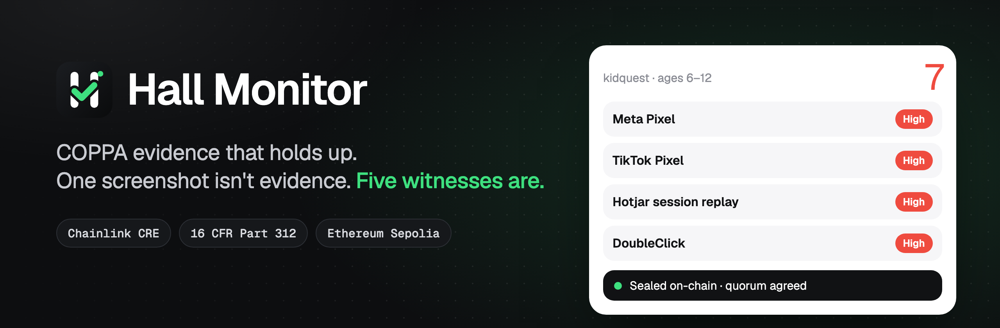
</p>

<p align="center">
  <b>Court-ready evidence of children's-privacy violations.</b><br>
  Independent Chainlink CRE nodes catch the trackers on kids' websites, map each one to COPPA, and seal the record on Ethereum so it can't be disputed or erased.
</p>

<p align="center">
  <a href="https://hall-monitor.codeswithroh.workers.dev/app/"></a>
  <a href="https://sepolia.etherscan.io/address/0x6f576CCa32A5f4337df8769E42a954d133167888"></a>
  <a href="https://github.com/codeswithroh/hall-monitor/actions/workflows/ci.yml"></a>
  <a href="LICENSE"></a>
</p>

<p align="center">
  <a href="https://hall-monitor.codeswithroh.workers.dev">Website</a> ·
  <a href="https://hall-monitor.codeswithroh.workers.dev/app/">Dashboard</a> ·
  <a href="https://hall-monitor.codeswithroh.workers.dev/kidquest/">Demo site</a> ·
  <a href="#quick-start">Quick start</a> ·
  <a href="#how-it-works">How it works</a>
</p>

<p align="center">
  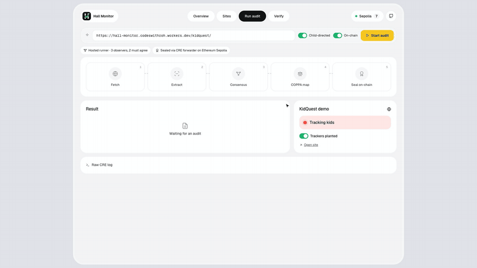
</p>

> **One screenshot isn't evidence. Five witnesses are.** Today a children's-privacy case rests on one
> investigator's crawl. The defence asks how it was captured, whether it was edited, and how long the tracker
> was really there. Hall Monitor answers all three on-chain.

Built for the [BLI Legal Tech Hackathon 2](https://dorahacks.io/hackathon/legal-hack-2026)
(LegalTech & RegTech: data privacy for minors) and the Chainlink **Best workflow with CRE** bounty.

## Contents

- [The problem](#the-problem)
- [Try it in two minutes](#try-it-in-two-minutes)
- [Features](#features)
- [How it works](#how-it-works)
- [Quick start](#quick-start)
- [Live deployment](#live-deployment)
- [Project layout](#project-layout)
- [Tech stack](#tech-stack)
- [Limits and roadmap](#limits-and-roadmap)

## The problem

<table>
  <tr>
    <td width="33%" valign="top">
      <h3>🎯 Kids are tracked</h3>
      Child-directed sites load ad pixels, session replay and fingerprinting before any parent has said yes.
      Under COPPA (16 CFR Part 312), that's personal information collected without verifiable parental consent.
    </td>
    <td width="33%" valign="top">
      <h3>📸 Proof is fragile</h3>
      A case rests on one investigator's screenshot. How was it captured? Was it edited? Nothing independent
      backs it up, and the defence knows it.
    </td>
    <td width="33%" valign="top">
      <h3>⏳ Duration is invisible</h3>
      Penalties are assessed per violation, so how long a tracker stayed matters. A single screenshot
      can't show when it started or whether it was ever removed.
    </td>
  </tr>
</table>

<p align="center">
  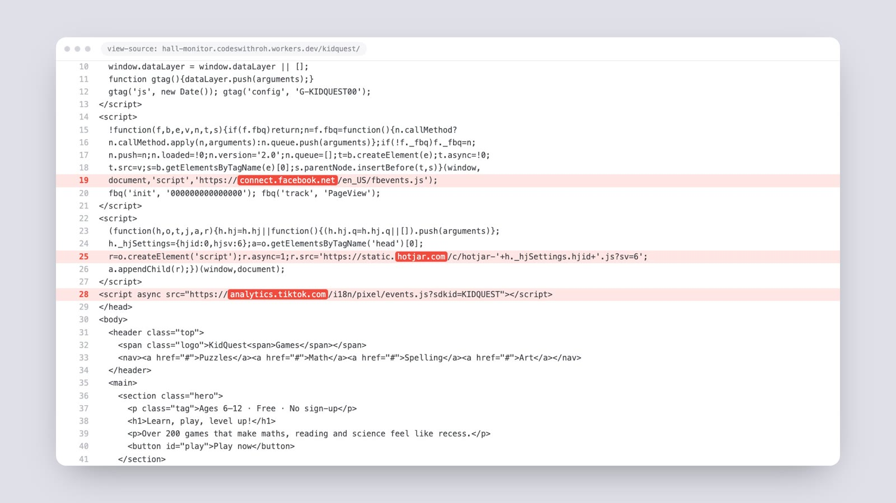
  <br><sub>KidQuest Games, our fictional site for 6–12 year olds, loads Meta, TikTok, Hotjar and Google trackers on the first page. All IDs are fake.</sub>
</p>

<p align="right"><a href="#top">back to top ↑</a></p>

## Try it in two minutes

1. Open the **[dashboard](https://hall-monitor.codeswithroh.workers.dev/app/)** → **Run audit** → **Start audit**.
   It audits the hosted [KidQuest demo](https://hall-monitor.codeswithroh.workers.dev/kidquest/) and seals the result on Sepolia.
2. Open **Overview**: the compliance gauge, the live tracker pins, the exposure radar and the observation record.
   Click any tracker for its COPPA citations.
3. Switch off **Trackers planted** and audit again. Every tracker turns **Remediated**, and its history stays.
4. Download the evidence pack and drop it into **Verify**: three checks, without trusting us.

## Features

<table>
  <tr>
    <td width="50%" valign="top">
      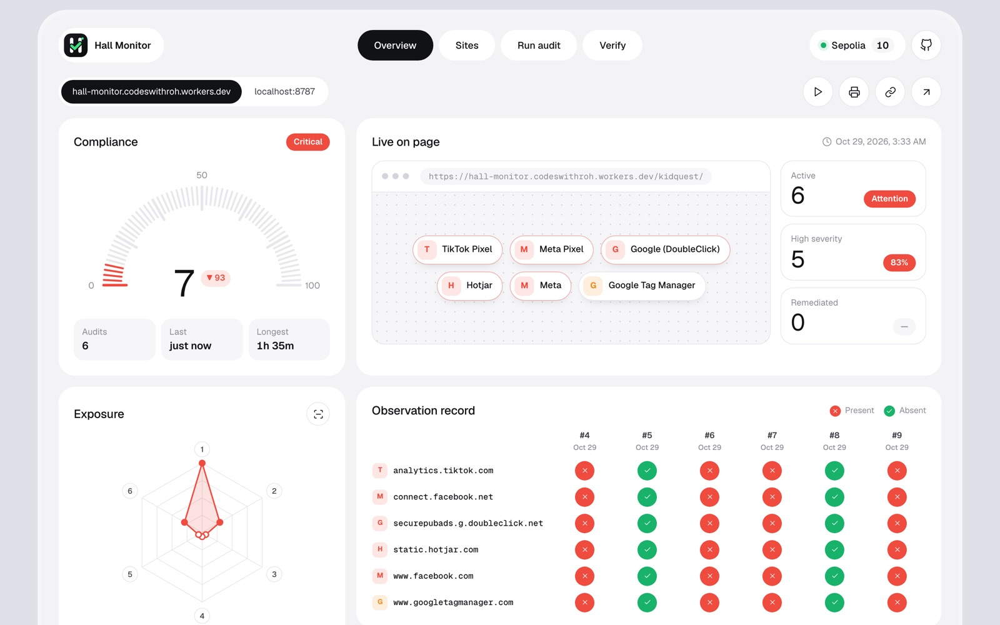
      <h4>Case file at a glance</h4>
      Compliance score with the change since the last audit, every tracker live on the page, exposure by category,
      and an observation record of each tracker across every audit.
    </td>
    <td width="50%" valign="top">
      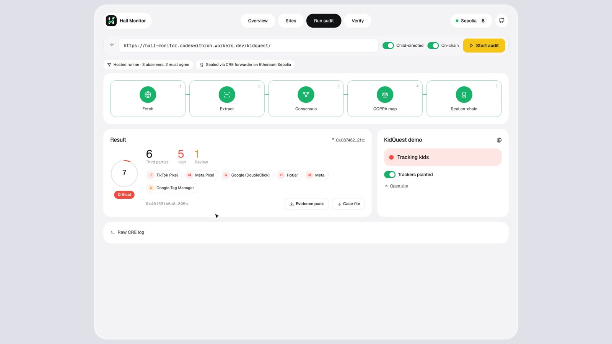
      <h4>Live audits from the browser</h4>
      Fetch → Extract → Consensus → COPPA map → Seal on-chain, with the result, the evidence hash and the
      Sepolia transaction a second later.
    </td>
  </tr>
  <tr>
    <td width="50%" valign="top">
      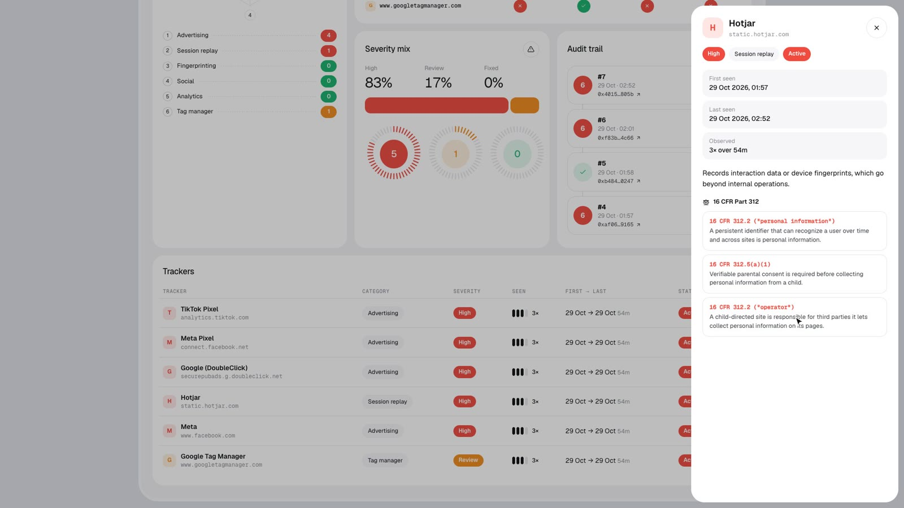
      <h4>Every finding cites the law</h4>
      Deterministic rules, not an AI guess, map each tracker to the 16 CFR Part 312 provisions it implicates.
      Every node reaches the same finding, and a lawyer can audit the logic.
    </td>
    <td width="50%" valign="top">
      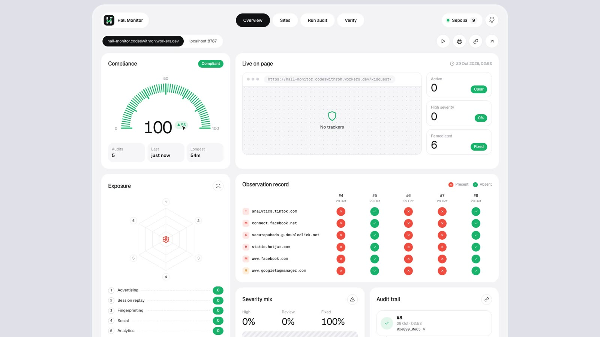
      <h4>Duration and remediation on record</h4>
      The contract keeps first-seen and last-seen for every tracker on every page, so the chain itself shows
      how long a violation lasted and when it was fixed.
    </td>
  </tr>
  <tr>
    <td width="50%" valign="top">
      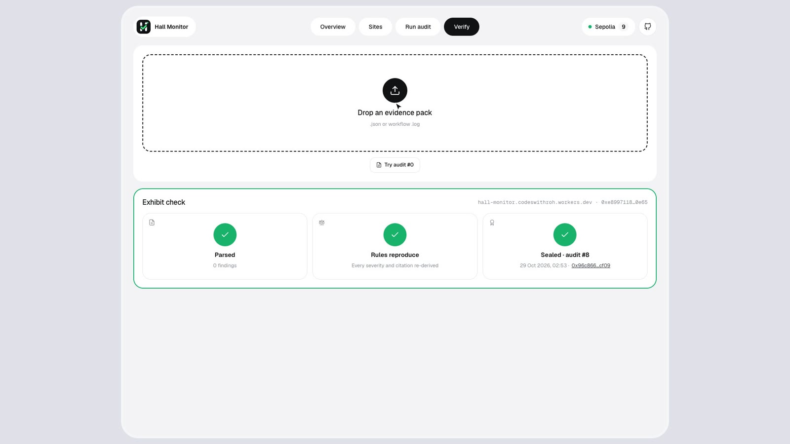
      <h4>Trustless verification</h4>
      Drop in an evidence pack. The browser re-hashes it, re-runs the published rules and finds the hash
      on-chain. A CLI verifier does the same: <code>bun run verify</code>.
    </td>
    <td width="50%" valign="top">
      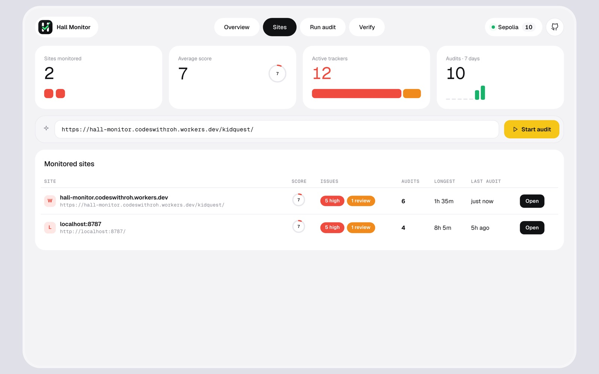
      <h4>Portfolio and exhibits</h4>
      Every monitored site with its score, issues and longest violation. One click exports a printable
      exhibit with findings, citations, hashes and transaction IDs.
    </td>
  </tr>
</table>

<p align="right"><a href="#top">back to top ↑</a></p>

## How it works

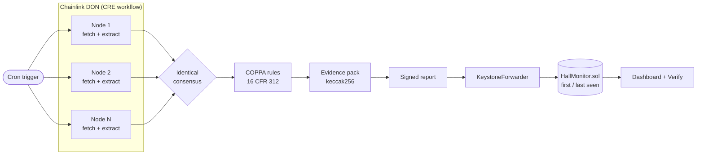

| Step | What happens | Code |
|---|---|---|
| **Observe** | Every node fetches the page and extracts third-party hosts from `script`, `img`, `iframe` and `link` tags and inline loaders | [`extract.ts`](cre/audit/extract.ts) |
| **Agree** | `consensusIdenticalAggregation` keeps only the host set a quorum produced | [`main.ts`](cre/audit/main.ts) |
| **Map** | Each host gets a category, a severity and the 16 CFR Part 312 citations | [`trackers.ts`](cre/audit/trackers.ts), [`coppa.ts`](cre/audit/coppa.ts) |
| **Seal** | The canonical evidence pack is hashed and written by a signed report | [`pack.ts`](cre/audit/pack.ts) |
| **Persist** | First-seen, last-seen and observation counts per page and tracker | [`HallMonitor.sol`](contracts/src/HallMonitor.sol) |

### Two ways audits run

| | Where | How it observes | How it's sealed |
|---|---|---|---|
| **CRE workflow** (canonical) | `cre workflow simulate`, or a deployed DON | each DON node fetches; identical consensus | signed report → KeystoneForwarder → `onReport` |
| **Hosted runner** (live demo) | Cloudflare Worker + Durable Object | 3 independent fetches; 2 must agree | same report encoding → CRE MockKeystoneForwarder → `onReport` |

Both run the same `extract.ts`, `coppa.ts` and `pack.ts`, and every evidence pack records which method observed it.
The hosted runner serializes audits so wallet nonces never collide, refuses private addresses, and rate-limits
on-chain writes (one every 12 s, 12 per IP per hour).

<p align="center">
  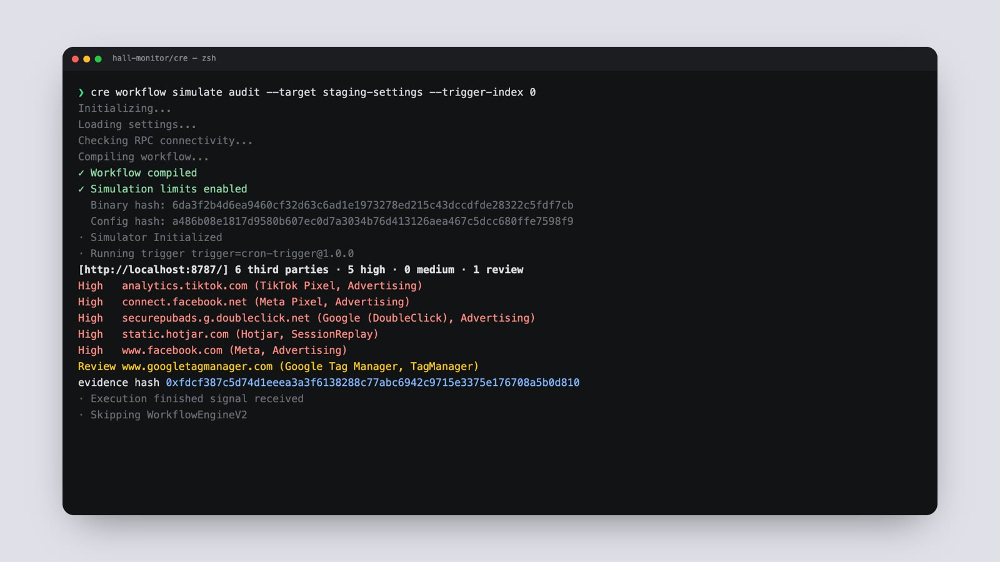
</p>

<p align="right"><a href="#top">back to top ↑</a></p>

## Quick start

Needs [Bun](https://bun.sh), [Foundry](https://getfoundry.sh) and the [CRE CLI](https://docs.chain.link/cre).

```bash
git clone --recurse-submodules https://github.com/codeswithroh/hall-monitor && cd hall-monitor
bun install && (cd cre/audit && bun install)
bun run test        # workflow unit tests + forge tests
bun run dev         # KidQuest on :8787, landing + dashboard on :5173 (/app)
```

Locally, **Run audit** calls the real `cre workflow simulate` and streams its output. It needs `cre login` and a
funded Sepolia testnet key:

```bash
cp cre/.env.example cre/.env      # CRE_ETH_PRIVATE_KEY, SEPOLIA_RPC
```

<details>
<summary><b>Run the CRE workflow from the terminal</b></summary>

```bash
cd cre
cre workflow simulate audit --target staging-settings --non-interactive --trigger-index 0 [--broadcast]
```

The log prints each finding, the evidence hash and the pack as numbered `EVIDENCE_PACK i/n` chunks, because the
simulator truncates long lines. Save the log and run `bun run verify that.log`.
</details>

<details>
<summary><b>Demo the remediation story locally</b></summary>

1. Run an audit with trackers on: 6 third parties, 5 high, all **Active**.
2. Switch off **Trackers planted**, or `curl -X POST localhost:8787/__remediate`.
3. Run again: 0 found. Overview shows every tracker **Remediated**, with its history kept.
4. Switch the trackers back on and run again: they return as **Active**, and the persistence span grows.
</details>

<details>
<summary><b>Deploy your own</b></summary>

1. Deploy the contract with the Sepolia mock forwarder `0x15fC6ae953E024d975e77382eEeC56A9101f9F88`
   (a deployed DON uses `0xF8344CFd5c43616a4366C34E3EEE75af79a74482`; both come from `cre workflow supported-chains`).
   Sepolia charges about 10M gas for this create, roughly 7× Foundry's local estimate, so pass an explicit limit:
   ```bash
   cd contracts
   forge create src/HallMonitor.sol:HallMonitor --rpc-url $SEPOLIA_RPC --private-key 0x$CRE_ETH_PRIVATE_KEY \
     --broadcast --gas-limit 12000000 --constructor-args 0x15fC6ae953E024d975e77382eEeC56A9101f9F88
   ```
2. Set `hallMonitorAddress` in `cre/audit/config.staging.json`, and `HALL_MONITOR` / `DEPLOY_BLOCK` in `web/src/config.ts`.
3. Deploy the site and hosted runner: `cd web && wrangler secret put CRE_ETH_PRIVATE_KEY`, then `bun run deploy`.

A DON-deployed workflow can't reach `localhost`, so host `demo-site/` publicly and update `targets`.
</details>

<p align="right"><a href="#top">back to top ↑</a></p>

## Live deployment

| | |
|---|---|
| Website | https://hall-monitor.codeswithroh.workers.dev |
| HallMonitor contract | [`0x6f576CCa32A5f4337df8769E42a954d133167888`](https://sepolia.etherscan.io/address/0x6f576CCa32A5f4337df8769E42a954d133167888) on Ethereum Sepolia |
| First audit (CRE CLI): 6 found, 5 high | [`0x85406bf7…8077`](https://sepolia.etherscan.io/tx/0x85406bf7d99dfaf1cd8880c64c4c0574d59f4f13fbaecd9212465742cf618077) · pack [`evidence/audit1.pack.json`](evidence/audit1.pack.json) |
| Remediated audit (CRE CLI): 0 found | [`0x2b8dbd62…0f01`](https://sepolia.etherscan.io/tx/0x2b8dbd62ff8e51282cbc1de60dfef6501c21ae13d412bc75587fc8b484120f01) · log [`evidence/audit2.log`](evidence/audit2.log) |
| Every audit since | the dashboard's audit trail, each linked to Etherscan |

```bash
bun run verify evidence/audit1.pack.json --rpc https://ethereum-sepolia-rpc.publicnode.com \
  --contract 0x6f576CCa32A5f4337df8769E42a954d133167888
```

## Project layout

```
cre/audit/      CRE workflow (TypeScript): main.ts, extract.ts, trackers.ts, coppa.ts, pack.ts
contracts/      HallMonitor.sol: CRE receiver with per-page, per-tracker persistence (Foundry)
web/            Landing page (/), dashboard (/app), hosted runner + KidQuest (Cloudflare Worker)
demo-site/      KidQuest Games: fictional kids' site with planted trackers and a remediate toggle
tools/verify.ts CLI verifier: re-hash a pack, re-derive its findings, confirm it on-chain
evidence/       Packs and logs from live Sepolia audits
brand/          Logo mark and lockups
submission/     DoraHacks copy and the demo video's edit sources
```

## Tech stack

<p>
  
  
  
  
  
  
  
</p>

## Limits and roadmap

**Known limits**
- **Static HTML only.** Tags injected at runtime, for example by Google Tag Manager, aren't visible to the
  extractor, which is why GTM itself is flagged for review.
- **Child-directed status is declared per target, not inferred.** Whether a site is directed to children is a
  multi-factor legal test under 16 CFR 312.2.
- **Flags exposure for legal review; it doesn't conclude liability.** Check citations against the current eCFR text.
- **Hostname matching is approximate.** The registrable domain is taken as the last two labels, which is wrong
  for suffixes like `.co.uk`.

**Roadmap**
- [x] CRE workflow with identical consensus and signed reports
- [x] On-chain persistence and remediation tracking
- [x] Trustless verification in the browser and the CLI
- [x] Hosted runner so anyone can audit from the live site
- [ ] Headless-browser observer per node, to catch tags injected at runtime
- [ ] Deploy to a production CRE DON with a public demo host
- [ ] Verifiable parental-consent detection (whether trackers wait for a consent gate)
- [ ] Coverage beyond COPPA: UK Age Appropriate Design Code, GDPR-K

## License

[MIT](LICENSE)

<p align="right"><a href="#top">back to top ↑</a></p>
